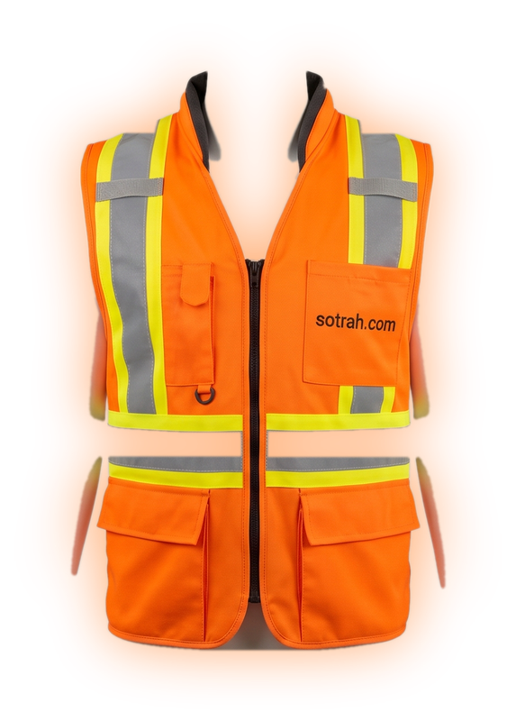
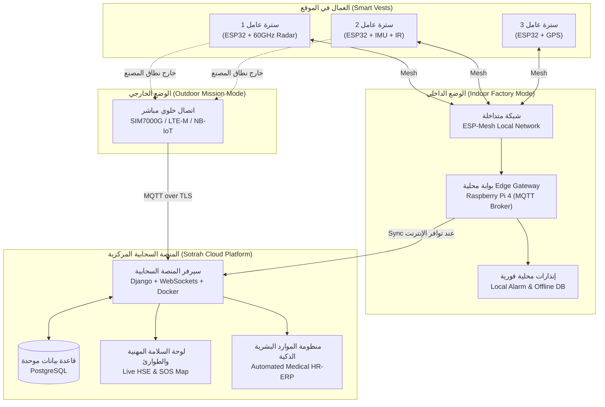
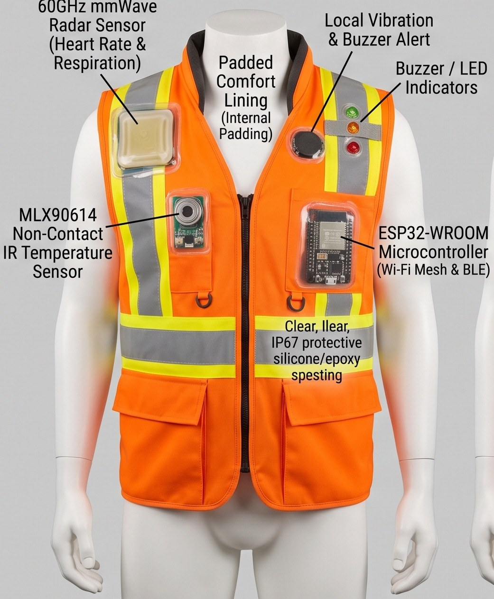
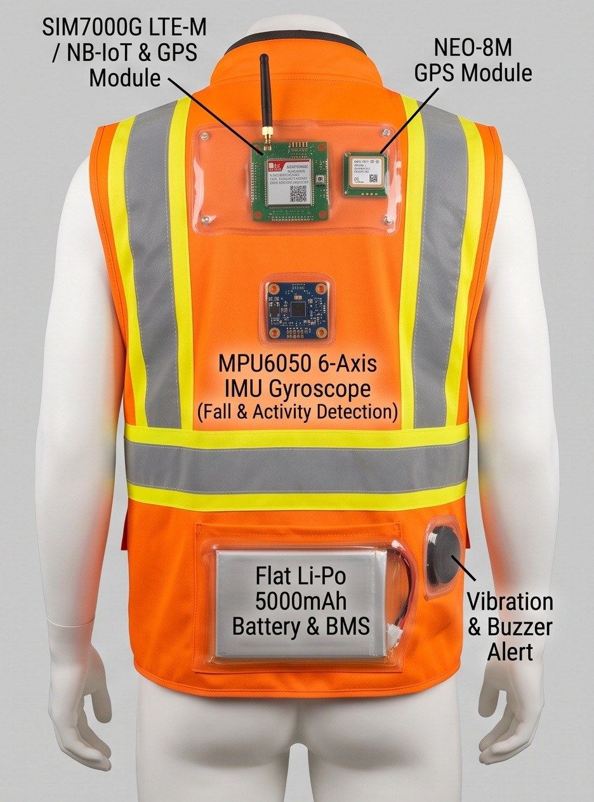
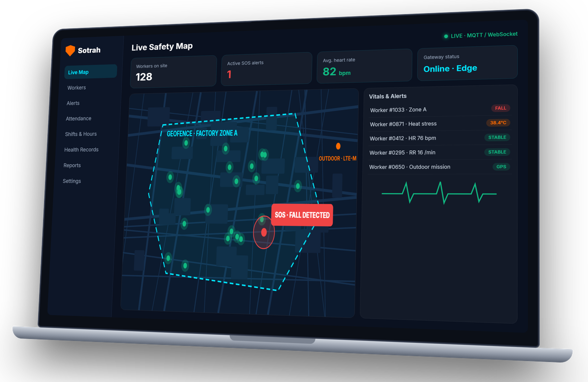
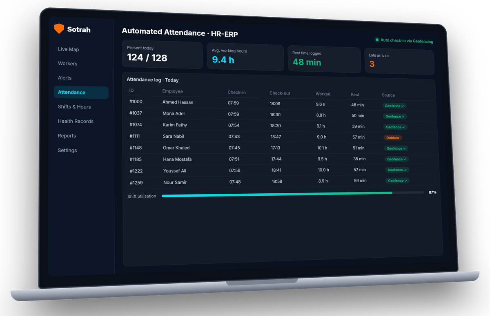
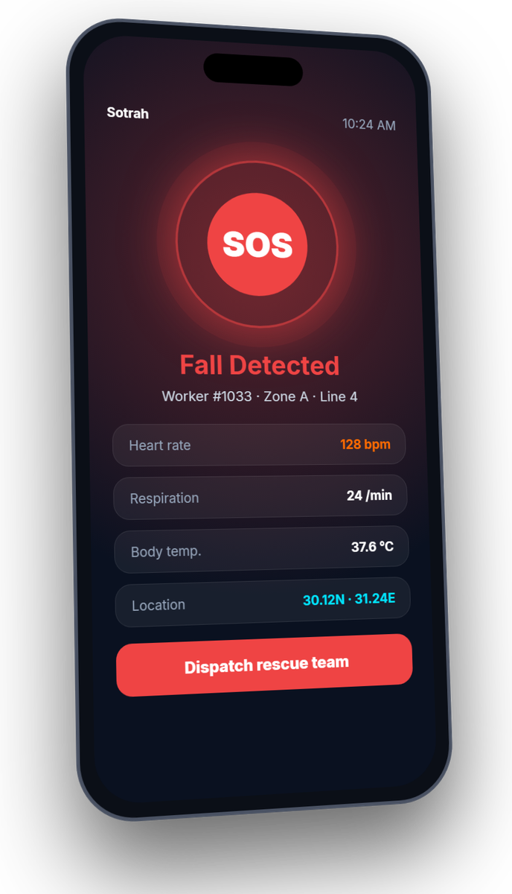

<p align="center">
  
</p>

<h1 align="center">سُترة | SOTRAH</h1>

<p align="center">
  <strong>منظومة تخطيط موارد المؤسسات الطبية الذكية (Medical HR-ERP) ومراقبة المؤشرات الحيوية وسلامة العاملين باستخدام سترة ذكية غير تلامسية قائمة على الرادارات وإنترنت الأشياء</strong>
  <br />
  <em>Smart Medical HR-ERP System Integrated with an IoT Non-Contact mmWave Radar Biometric and Location-Tracking Smart Vest</em>
</p>

<p align="center">
  <a href="https://sotrah.com"></a>
  <a href="#academic-supervision--team"></a>
  <a href="#tech-stack"></a>
  <a href="#hardware-architecture"></a>
  <a href="#license"></a>
</p>

<p align="center">
  <strong>« سُترة .. لأن سلامتك تهمنا | Safer People .. Smarter Workplaces »</strong>
</p>

---

## 📑 فهرس المحتويات | Table of Contents
1. [نظرة عامة على المشروع (Overview)](#-نظرة-عامة-على-المشروع--project-overview)
2. [المشكلة والتحدي الميداني (Problem Statement)](#-المشكلة-والتحدي-الميداني--problem-statement)
3. [الحل المقترح والقيمة المضافة (The Solution)](#-الحل-المقترح-والقيمة-المضافة--the-solution)
4. [معمارية النظام وأنماط الاتصال (System Architecture)](#-معمارية-النظام-وأنماط-الاتصال--system-architecture)
5. [المكونات الهندسية للسترة الذكية (Hardware Breakdown)](#-المكونات-الهندسية-للسترة-الذكية--smart-vest-hardware)
6. [المنصة السحابية والبرمجيات (Cloud Platform & Tech Stack)](#-المنصة-السحابية-والبرمجيات--cloud-platform--software)
7. [مؤشرات التحقق والضوابط العلمية (Validation KPIs & Boundaries)](#-مؤشرات-التحقق-والضوابط-العلمية--kpis--scientific-boundaries)
8. [القطاعات المستهدفة ونموذج العمل (Target Sectors & Roadmap)](#-القطاعات-المستهدفة-ونموذج-العمل--target-sectors--business-roadmap)
9. [الميزانية التفصيلية للمشروع (Project Budget)](#-الميزانية-التفصيلية-للمشروع--project-budget)
10. [الإشراف الأكاديمي وفريق العمل (Supervision & Team)](#-الإشراف-الأكاديمي-وفريق-العمل--supervision--team)
11. [هيكل المستودع (Repository Structure)](#-هيكل-المستودع--repository-structure)

---

## 💡 نظرة عامة على المشروع | Project Overview

مشروع **«سُترة» (Sotrah)** هو مشروع تخرج تطبيقي ومقترح شركة ناشئة متخصصة في حلول إنترنت الأشياء الصناعي والصحي (**IIoT / IoMT**). يجمع المشروع في منظومة واحدة موحدة بين:
1. **عتاد ميداني متقدم (Smart Wearable Vest):** سترة أمان ذكية صناعية مزودة برادار موجات مليمترية غير تلامسي تردد **60GHz** لرصد النبض والتنفس من فوق الملابس دون الحاجة لملامسة الجلد مباشرة، مع مجسات حرارة تحت الحمراء (IR)، ووحدة قياس القصور الذاتي (IMU) لرصد السقوط المفاجئ والإجهاد البدني وحالات الطوارئ.
2. **بوابة معالجة حافة محلية (Edge Gateway):** تعتمد على **Raspberry Pi 4** مع وسيط **MQTT Broker** لتشغيل المصنع في بيئة **Offline-First**، وتوليد الإنذارات اللحظية دون انتظار اتصال الإنترنت.
3. **منصة سحابية متكاملة (Sotrah Medical HR-ERP):** تدمج لأول مرة بين لوحة قيادة حية للسلامة والصحة المهنية (**HSE & SOS**) ومنظومة أتمتة إدارة الموارد البشرية (**HR-ERP**) لتسجيل الحضور والانصراف الذكي عبر السياج الجغرافي (**Geofencing**) وحساب ساعات العمل الفعلية وفترات الراحة.

<p align="center">
  
</p>

---

## ⚠️ المشكلة والتحدي الميداني | Problem Statement

في المنشآت الصناعية والمواقع الإنشائية وحقول النفط والتعدين:
* **انفصال الأنظمة التشغيلية:** غياب الربط بين بيانات السلامة الميدانية وسجلات الموارد البشرية، مما يمنع تكوين صورة تشغيلية موحدة وشاملة لحالة القوى العاملة.
* **تأخر الاستجابة للحوادث:** الاعتماد على الإبلاغ اليدوي عند حدوث سقوط أو إغماء أو إجهاد حراري يضيع دقائق ذهبية حرجة لإنقاذ حياة العامل.
* **صعوبة المتابعة في المساحات الشاسعة:** تشتت العمال في المواقع البعيدة وصعوبة حصر تواجدهم وساعات عملهم الميدانية بدقة وتأكيد التزامهم بنطاقات العمل المحددة.
* **الحاجة لأتمتة الحضور والسلامة:** غياب آلية رقمية تدمج التحقق من المؤشرات الحيوية أثناء تسجيل الورديات وأوقات الراحة المستحقة لتقليل الإجهاد المهني.

---

## ✨ الحل المقترح والقيمة المضافة | The Solution

يقدم مشروع «سُترة» نموذجاً هجيناً متكاملاً (**Hardware + SaaS**):
* **استشعار حيوي غير تلامسي:** مراقبة حيوية غير مزعجة للعامل تقيس النبض والتنفس ودرجة الحرارة من خلال السترة مباشرة دون لاصقات طبية أو أسلاك تعيق حركته أثناء العمل الشاق.
* **استجابة فورية للحوادث:** خوارزمية ذكية مدمجة للكشف عن السقوط المفاجئ والاصطدام، مع إرسال استغاثة فورية وإطلاق تنبيه اهتزازي وصوتي محلي للعامل.
* **أتمتة الحضور والموارد البشرية:** تحضير تلقائي للعمال فور دخول الموقع المعتمد، وربط الإجهاد البدني بتوصيات الراحة ضمن نظام الـ ERP.
* **تكلفة اقتصادية واستدامة تشغيلية:** صممت السترة لتعمل أكثر من **10 ساعات متواصلة** ببطارية واحدة، مع استهلاك بيانات فائق الاقتصادية **≤ 0.5 MB** طوال الوردية عند استخدام الاتصال الخلوي.

---

## 🌐 معمارية النظام وأنماط الاتصال | System Architecture

يعمل نظام «سُترة» وفق نمطين اتصال مرنين لضمان استمرارية العمل في جميع بيئات العمل:



### 1. الوضع الداخلي داخل المصنع (Indoor Factory Mode):
* تتواصل السترات فيما بينها عبر شبكة متداخلة (**ESP-Mesh**)، وتمرر البيانات تلقائياً دون الحاجة لشبكة Wi-Fi تقليدية تغطي كل نقطة.
* تستقبل بوابة المعالجة المحلية (**Raspberry Pi 4**) البيانات محلياً عبر وسيط **Mosquitto MQTT** لتشغيل الإنذارات اللحظية.
* تحتوي البوابة على نظام تخزين احتياطي محلي (**Offline Buffer**) يحفظ كافة القراءات في حال انقطاع خدمة الإنترنت ويعيد مزامنتها تلقائياً فور عودة الاتصال.

### 2. وضع المأموريات الميدانية الخارجية (Outdoor Mission Mode):
* عند خروج العامل في مأموريات مفتوحة خارج المنشأة، تتحول السترة ذاتياً للبث المباشر عبر شريحة **SIM7000G / SIM7600 (LTE-M / NB-IoT)** مع تفعيل قراءات الـ **GPS** لتحديد الموقع والسياج الجغرافي.
* يتم إرسال حزم بيانات خفيفة ومضغوطة تستهلك أقل من نصف ميجابايت طوال الوردية (10 ساعات).

---

## 🛠️ المكونات الهندسية للسترة الذكية | Smart Vest Hardware

<p align="center">
  
  &nbsp;&nbsp;
  
</p>

| المكون الإلكتروني / الخامة | الموديل / المواصفات | الدور الوظيفي في السترة |
| :--- | :--- | :--- |
| **رادار الموجات المليمترية غير التلامسي** | `60GHz mmWave Radar` | استشعار دقات القلب ومعدل التنفس عبر الملابس دون ملامسة الجلد |
| **مستشعر الحرارة بالأشعة تحت الحمراء** | `MLX90614 Non-Contact IR` | قياس درجة حرارة جسم العامل والحرارة المحيطة بدقة عالية |
| **وحدة قياس الحركة والقصور الذاتي** | `MPU6050 6-Axis Gyro/Accel` | خوارزميات رصد السقوط المفاجئ، الصدمات، وحالات الإجهاد وحركة العامل |
| **المعالج الدقيق الأساسي** | `ESP32-WROOM-32U Dual-Core` | إدارة القراءات، الفلترة الرقمية، وبناء شبكة الـ ESP-Mesh |
| **وحدة الاتصال الخلوي وتحديد الموقع** | `SIM7000G / SIM7600 LTE-M/GPS` | نقل البيانات في المأموريات الخارجية عبر شبكات الجيل الرابع الخفيفة |
| **مستشعر الملاحة الفضائية عالي الدقة** | `NEO-8M High Precision GPS` | دعم السياج الجغرافي (Geofencing) وتتبع مسار العامل في المواقع المفتوحة |
| **بوابة المعالجة والحافة المحلية** | `Raspberry Pi 4 Model B (4GB)` | سيرفر وبوابة وسيطة محلية (MQTT Broker) ومعالجة الطوارئ أوفلاين |
| **منظومة التغذية المستمرة** | `Li-Po 5000mAh Battery + BMS` | بطارية بوليمر مسطحة خفيفة مع دائرة حماية متطورة تكفي لأكثر من 10 ساعات |
| **وحدة التنبيه والتحذير المحلي** | `Buzzer + Haptic Vibration Motor` | تنبيه العامل محلياً عند الخطر، تجاوز حدود النبض، أو موعد انتهاء الراحة |
| **العزل الصناعي والحماية** | `RTV Silicone & Epoxy Resin` | تغليف وعزل الإلكترونيات لمقاومة العرق الشديد، الأتربة، ورذاذ الماء (IP67) |
| **الهيكل الخارجي والحوافظ** | `3D Printed Enclosures + High-Vis Vest` | حوافظ مرنة مطبوعة بتقنية 3D مدمجة بجيوب وبطانة سترة السلامة الفسفورية |

---

## 💻 المنصة السحابية والبرمجيات | Cloud Platform & Software

تم تصميم المنصة السحابية **(sotrah.com)** كمنظومة تخطيط موارد مؤسسية ذكية مخصصة للسلامة المهنية وإدارة الكوادر الميدانية (**Medical HR-ERP**):

<p align="center">
  
  &nbsp;
  
</p>

### 1. نظام السلامة المهنية والطوارئ (Occupational Safety & SOS):
* **خريطة حية تفاعلية:** عرض لحظي لانتشار العمال وحالتهم الصحية في كل قطاع تشغيلي.
* **مركز تنبيهات الطوارئ:** إطلاق إنذارات مرئية وصوتية فورية بمجرد رصد سقوط عامل أو خروج المؤشرات الحيوية (النبض، التنفس، الحرارة) عن المعدلات الطبيعية.
* **زر الاستغاثة (SOS):** إمكانية إرسال إشارة استغاثة يدوية من السترة مباشرة إلى مشرف الوردية.
* **الأرشفة والتحليل:** الاحتفاظ بسجل تاريخي مشفر لكل حدث أو أزمة صحية للمراجعة الدورية.

### 2. نظام الموارد البشرية المؤتمت (Automated Smart HR-ERP):
* **تحضير لا تلامسي مؤتمت:** تسجيل حضور وانصراف العمال تلقائياً استناداً إلى تقنية السياج الجغرافي الميداني (**Geofencing**).
* **حساب ساعات العمل وفترات الراحة:** مراقبة الجهد البدني والراحة المستحقة وفقاً لمعايير السلامة المهنية لمنع الإجهاد الحراري والجسدي.
* **تقارير دورية متقدمة:** إصدار تقارير تفصيلية عن إنتاجية الورديات، معدلات الامتثال للسلامة، ومؤشرات الأداء التشغيلي.

<p align="center">
  
</p>

### التقنيات البرمجية المستخدمة (Tech Stack):
* **الواجهة الخلفية (Backend):** Python / Django Framework & Django REST Framework.
* **الواجهة الأمامية (Frontend):** React.js مع Vite و Tailwind CSS لتجربة مستخدم سريعة وعصرية.
* **قاعدة البيانات (Database):** PostgreSQL مع دعائم التخزين الزمني (Time-Series Optimization).
* **بروتوكولات الاتصال اللحظي:** WebSockets لنقل التحديثات للشاشة دون تحديث الصفحة + MQTT لنقل رسائل الحساسات.
* **الحاويات والتشغيل:** Docker & Docker Compose للنشر السحابي السهل والموثوق.

---

## 🎯 مؤشرات التحقق والضوابط العلمية | KPIs & Scientific Boundaries

### مؤشرات قياس الأداء الفني (Validation KPIs):
1. **دقة القياسات (Measurement Accuracy):** مقارنة قراءات الرادار ومستشعر الحرارة بالأجهزة الطبية المرجعية وتوثيق هامش الخطأ بدقة.
2. **موثوقية رصد السقوط (Fall Detection Reliability):** تقييم حساسية خوارزمية السقوط وتقليل نسبة الإنذارات الخاطئة (**False Positives**) أثناء الحركة الطبيعية.
3. **زمن الاستجابة (Latency):** ضمان وصول إشارة التنبيه للوحة القيادة في أقل من ثانيتين من لحظة وقوع الحادث.
4. **عمر البطارية واستعادة البيانات (Battery & Data Recovery):** تشغيل متواصل للسترة يتجاوز 10 ساعات، واستعادة 100% من الرسائل المخزنة محلياً عند عودة الاتصال.

### الضوابط الأخلاقية وحدود النموذج الأولي (Ethical Boundaries):
* **نموذج أولي بحثي:** هذا المشروع هو نموذج بحثي أولي؛ ولا تُعرض المؤشرات الحيوية أو تقديرات ضغط الدم كبديل للتشخيص الطبي المعتمد قبل إجراء التحقق السريري والمرجعي المستقل.
* **خصوصية وسرية البيانات:** تخضع كافة البيانات الصحية والشخصية لضوابط أمان وتشفير صارمة وفق مبدأ تقليل البيانات (**Data Minimization**).

---

## 🚀 القطاعات المستهدفة ونموذج العمل | Target Sectors & Business Roadmap

### القطاعات الصناعية المستهدفة:
* **المصانع والمناطق الصناعية الكبرى:** حماية عمال خطوط الإنتاج والبيئات المعرضة لدرجات حرارة عالية.
* **شركات المقاولات والبناء والتشييد:** متابعة عمال السقالات والمباني المرتفعة ورصد السقوط الفوري.
* **شركات البترول والتعدين:** حقول النفط البرية والبحرية والمناجم ذات المخاطر المرتفعة.
* **الموانئ والمستودعات والخدمات اللوجستية:** إدارة وتتبع حركة عمال الشحن والرافعات على مدار الورديات.

### نموذج العمل المقترح (Hardware + SaaS):
* **مبيعات العتاد (Hardware Sales):** توفير وتجهيز السترات الذكية وبوابات المعالجة المحلية.
* **اشتراك المنصة السحابية (SaaS Subscriptions):** اشتراك سنوي أو شهري لكل عامل مرخص للاستفادة من لوحة التحكم، تقارير الـ ERP، والنسخ الاحتياطي السحابي.

### خطة التطوير (2-Year Roadmap):
1. **تصميم لوحة إلكترونية مخصصة (Custom PCB):** دمج كافة المعالجات والمستشعرات في شريحة مدمجة صغيرة الحجم لتقليل الوزن والتكلفة.
2. **شراكات التصنيع المحلي (EMS & PPE):** التعاون مع مصانع الإلكترونيات ومهمات الوقاية الشخصية في مصر لتصنيع السترات بكميات تجارية مطابقة لمعايير السلامة الدولية.

---

## 💰 الميزانية التفصيلية للمشروع | Project Budget

> الميزانية الإجمالية المعتمدة لتطوير عدد (3) نماذج أولية للسترة الذكية وبوابة المعالجة المحلية والاستضافة السحابية لمدة عام هي **73,025 جنيه مصري**:

| البند والمكون | الكمية | التكلفة الإجمالية (ج.م) | النسبة من الميزانية |
| :--- | :---: | :---: | :---: |
| **المستشعرات والوحدات الإلكترونية الأساسية**<br/>*(رادارات 60GHz، مجسات IR، MPU6050، وحدات ESP32، وحدات SIM7000G، GPS، وبوابة Raspberry Pi 4)* | 3 مجموعات كاملة + 1 بوابة | **30,100** | 41.2% |
| **منظومة الطاقة والتنبيه المحلي**<br/>*(بطاريات Li-Po 5000mAh، دوائر شحن وحماية BMS، ومحركات اهتزاز وتنبيه)* | 4 بطاريات + دوائر | **4,600** | 6.3% |
| **السترات والعزل الكيميائي والتصنيع**<br/>*(سترات أمان صناعية، حوافظ 3D مرنة، سيليكون وإيبوكسي IP67، وأسلاك وموصلات)* | 3 سترات ومجموعات عزل | **8,800** | 12.1% |
| **البنية السحابية واللوجستيات والضرائب**<br/>*(استضافة سحابية VPS وقاعدة بيانات ونطاق sotrah.com، شحن وجمارك وضرائب 15%)* | سنة كاملة | **29,525** | 40.4% |
| **الإجمالي العام للمشروع** | — | **73,025 ج.م** | **100%** |

---

## 🎓 الإشراف الأكاديمي وفريق العمل | Supervision & Team

### الإشراف الأكاديمي | Academic Supervisor
* **د. محمود حردان** – عضو هيئة تدريس، كلية تكنولوجيا الصناعة والطاقة، جامعة أسيوط الجديدة التكنولوجية.

### فريق عمل المشروع | Project Development Team
مشروع تخرج طلاب **قسم تكنولوجيا المعلومات** – **كلية تكنولوجيا الصناعة والطاقة** – **جامعة أسيوط الجديدة التكنولوجية**:

1. **فادي أشرف صلاح (Fady Ashraf Salah)** – *قائد الفريق ومطور المنظومة (Team Leader)*
2. **يوسف تامر صلاح الدين (Youssef Tamer Salah El-Din)**
3. **بيشوى ميشيل مختار (Bishoy Misheal Mokhtar)**
4. **يوسف حاتم يوسف حسن (Youssef Hatem Youssef Hassan)**
5. **أسماء جمال علي مهران (Asmaa Gamal Ali Mehran)**
6. **شهد ماهر لطفي (Shahd Maher Lotfy)**
7. **شهد محمد جمال (Shahd Mohamed Gamal)**
8. **إسراء محمد عبدالكريم (Esraa Mohamed Abdelkareem)**

---

## 📁 هيكل المستودع | Repository Structure

```text
SOTRAH/
│
├── assets/                               # الصور والرسوم التوضيحية وشعار المشروع
│   ├── logo.png                          # الشعار الرسمي لمنظومة سُترة
│   ├── vest_overview.png                 # المخطط الهندسي التوضيحي للسترة
│   ├── vest_front.jpg                    # صورة الواجهة الأمامية للسترة
│   ├── vest_back.jpg                     # صورة الواجهة الخلفية ومنظومة الطاقة
│   ├── dashboard_live.png                # واجهة لوحة قيادة السلامة والطوارئ الحية
│   ├── dashboard_hr.png                  # واجهة نظام إدارة الموارد البشرية (HR-ERP)
│   └── mobile_preview.png                # معاينة واجهة تطبيق الهاتف المحمول
│
├── Sotrah_Graduation_Project.docx        # مستند توصيف المشروع الأكاديمي التفصيلي
├── Sotrah_Presentation_Deck.pptx         # العرض التقديمي النهائي للمشروع (12 شريحة)
├── takdiim.docx                          # نموذج التقديم لبرامج دعم وتمويل مشروعات التخرج
├── takdiim_updated.docx                  # النسخة المحدثة لنموذج التقديم
├── .gitignore                            # استثناء الملفات المؤقتة وملفات النظام
└── README.md                             # وثيقة التعريف الشاملة بالمشروع
```

---

<p align="center">
  <strong>© 2026 SOTRAH (سُترة) — All Rights Reserved</strong><br />
  <em>New Assiut Technology University · Faculty of Industry and Energy Technology</em>
</p>
